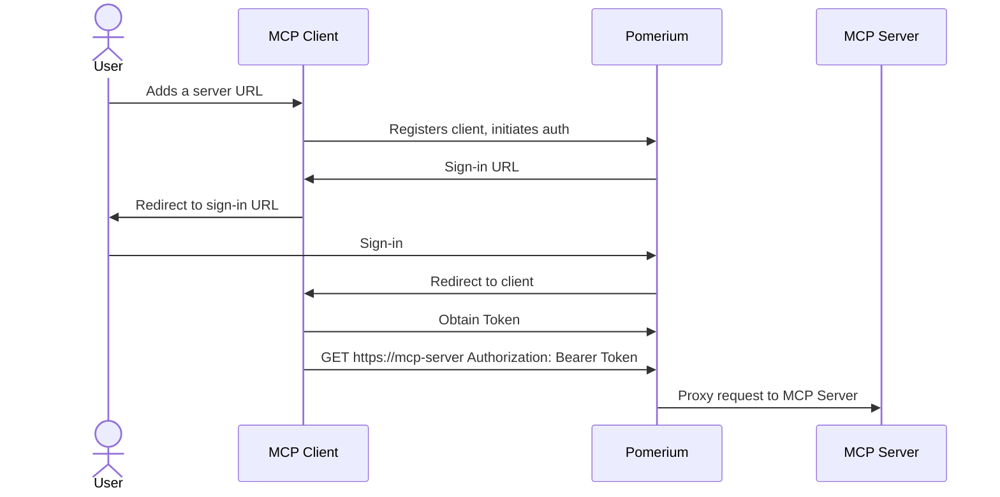

# Protect an MCP Server

Use Pomerium to expose an internal MCP server to MCP clients (Claude, ChatGPT, VS Code, and others) without adding authentication logic to the server itself.

:::tip Interactive Lesson

Try the [**Secure an MCP Server with a Pomerium HTTP Route**](https://go.pomerium.com/mcp-course-l2) interactive lesson for a hands-on walkthrough. It's part of the full [Securing MCP Servers and MCP Apps with Pomerium](https://go.pomerium.com/mcp-course?utm_source=docs&utm_medium=docs&utm_campaign=mcp-course) course. It's free to use, but you'll need to create an account.

:::

**What you get:**

- External MCP clients authenticate through Pomerium — your server stays auth-free
- Deny-based policies block destructive tools while allowing everything else
- Full observability of every tool call via [authorize log fields](/docs/capabilities/mcp/reference#observability)

## Architecture



## Configuration

```yaml
routes:
  - from: https://my-mcp-server.your-domain.com
    to: http://my-mcp-server.int:8080/mcp
    name: My MCP Server
    mcp:
      server: {} # the brackets are significant, they indicate that this is an MCP server route
    policy:
      allow:
        and:
          - domain:
              is: company.com
      # Block destructive tools (example: any tool prefixed with admin_)
      deny:
        and:
          - mcp_tool:
              starts_with: 'admin_'
```

## Step-by-step

### 1. Run your MCP server

Start any MCP server that speaks the HTTP Streamable transport. It does **not** need to handle authentication — Pomerium takes care of that.

```bash
# Example: start one of the sample servers from the pomerium/mcp-servers repo
docker compose up -d
```

### 2. Add the route to Pomerium

Add the route configuration shown above to your Pomerium config. Key points:

- `mcp.server: {}` tells Pomerium this route fronts an MCP server
- The `policy` block controls who can access the server and which tools are allowed
- See [Limit MCP Tool Calling](/docs/capabilities/mcp/limit-mcp-tools) for advanced policy patterns

### 3. Allow MCP clients

Most MCP clients, such as VS Code, Claude, and ChatGPT, identify themselves with a [Client ID Metadata Document](https://datatracker.ietf.org/doc/html/draft-ietf-oauth-client-id-metadata-document) (CIMD): their client ID is an HTTPS URL that publishes the client's metadata, including its redirect URIs. Pomerium accepts a client ID only if its domain is listed in `mcp_allowed_client_id_domains`:

```yaml
mcp_allowed_client_id_domains:
  - 'vscode.dev'
```

Clients from other domains see an error page when they try to sign in. List only clients you trust: the allowlist decides which applications can obtain tokens that act on behalf of your users, and which domains Pomerium fetches client metadata from. See [Allowed Client ID Domains](/docs/capabilities/mcp/reference#allowed-client-id-domains).

For clients that only support Dynamic Client Registration (DCR), which the MCP specification deprecated in favor of CIMD, enable the `mcp_dynamic_client_registration` [runtime flag](/docs/reference/runtime-flags).

### 4. Connect an MCP client

Point any MCP-compatible client at the Pomerium route URL. The client will go through Pomerium's OAuth flow, receive a bearer token, and use it for all subsequent requests.

```
Server URL: https://my-mcp-server.your-domain.com
```

### 5. Verify with the MCP Inspector

Use the MCP Inspector to confirm connectivity:

```bash
npx -y @modelcontextprotocol/inspector@latest
```

- Transport type: Streamable HTTP
- URL: `https://my-mcp-server.your-domain.com`
- Enable OAuth (Quick OAuth Flow)
- Click **Connect**, then **Tools → List Tools**

## Sample repos and next steps

- **[pomerium/mcp-servers](https://github.com/pomerium/mcp-servers)** — Example MCP server implementations with Docker and Pomerium configs
- [Limit MCP Tool Calling](/docs/capabilities/mcp/limit-mcp-tools) — Fine-grained PPL policies for tool access
- [MCP Full Reference](/docs/capabilities/mcp/reference) — Token types, session lifecycle, observability
